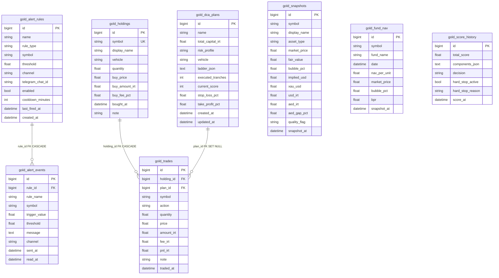
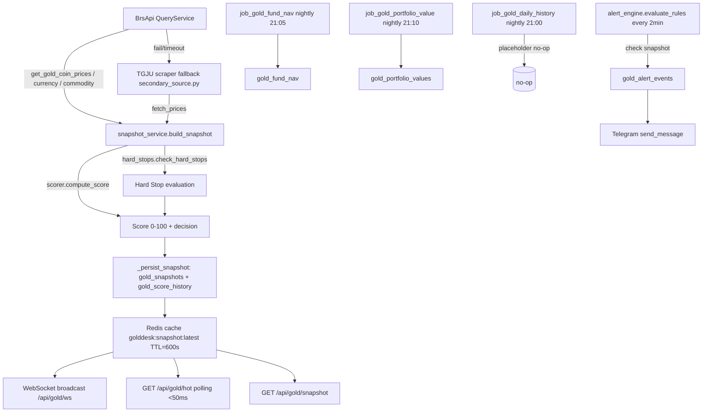

# گزارش تحلیل بخش GoldDesk — ریپو temce

**محدوده تحلیل:** `src/gold_desk/`, `brsapi/jobs/gold_desk_jobs.py`, `apps/scheduler`, `migrations/` (متعلق به طلا)، `Dockerfile.golddesk`, `nginx-golddesk.conf`, `docker-compose*.yml`, `monitoring/golddesk-prometheus.yml`, `tests/load/`
**راهنمای برچسب‌ها:** `[کد]` = مستقیماً از کد/فایل مشاهده شد؛ `[استنباط]` = استنتاجی بر اساس کد؛ `[پیشنهاد]` = پیشنهاد ایمنی/کارکردی.
**قاعده:** چیزی که مشاهده نشد، بنویسم «مشاهده نشد». هیچ فایلی تغییر نمی‌یابد.

---

# ۱. خلاصه اجرایی

بخش GoldDesk یک ماژول FastAPI با prefix `/gold` است که هر ۵ دقیقه snapshot بازار طلا/سکه/ارز/صندوق را از BrsApi (با fallback به TGJU) می‌سازد، امتیاز ۰-۱۰۰ محاسبه می‌کند، قوانین هشدار را ارزیابی می‌کند و از طریق WebSocket و تلگرام پخش می‌کند. پنج جدول SQLAlchemy (۵ جدول در migration 0041) و سه جدول پورتفوی (migration 0042) دارد. احراز هویت از طریق API-token ساده با hash SHA256 + salt در Redis است.

**نکات کلیدی مشاهدات:**
- ۵۶ endpoint در `api.py` مشاهده شد (خطوط ۹۵-۱۵۵۳) در حالی که PLAN_GOLD.md اشاره‌های کمرک‌شده‌ای دارد (بخش ۴).
- WebSocket فقط از طریق `token` query parameter احراز هویت می‌شود (`api.py` خط ۶۹۳-۷۰۸).
- `/macro/scrape` بدون scopes محافظت می‌شود (بخش ۶).
- Redis keys TTL ندارند (پرسistible) — بخش ۳.
- هیچ hypertable Timescale در migrations طلا مشاهده نشد (بخش ۲).
- تست یکپارچه برای قطع منبع/timeout/قطع Redis در `tests/gold_desk/` مشاهده نشد.

---

# ۲. دیکشنری داده و ERD

## ۲.۱ جداول دیتابیس (۵ جدول از migration 0041 + ۳ جدول از migration 0042)

Migration `0041_gold_desk.py` [کد: `migrations/versions/0041_gold_desk.py`] پنج جدول می‌سازد. Migration `0042_gold_portfolio.py` [کد: `migrations/versions/0042_gold_portfolio.py`] سه جدول اضافه می‌کند. کل ۸ جدول GoldDesk است.

### جدول ۱: `gold_snapshots`

| ستون | نوع | قید | ایندکس | FK | Hypertable | Retention |
|-------|-----|-----|--------|----|------------|-----------|
| id | BigInteger | PK, autoincrement | — | — | مشاهده نشد | مشاهده نشد |
| symbol | String(32) | NOT NULL | index | — | مشاهده نشد | مشاهده نشد |
| display_name | String(64) | NOT NULL | — | — | مشاهده نشد | مشاهده نشد |
| asset_type | String(16) | NOT NULL | — | — | مشاهده نشد | مشاهده نشد |
| market_price | Float | NOT NULL | — | — | مشاهده نشد | مشاهده نشد |
| fair_value | Float | NULL | — | — | مشاهده نشد | مشاهده نشد |
| bubble_abs | Float | NULL | — | — | مشاهده نشد | مشاهده نشد |
| bubble_pct | Float | NULL | — | — | مشاهده نشد | مشاهده نشد |
| implied_usd | Float | NULL | — | — | مشاهده نشد | مشاهده نشد |
| xau_usd | Float | NULL | — | — | مشاهده نشد | مشاهده نشد |
| usd_irt | Float | NULL | — | — | مشاهده نشد | مشاهده نشد |
| aed_irt | Float | NULL | — | — | مشاهده نشد | مشاهده نشد |
| aed_parity_usd | Float | NULL | — | — | مشاهده نشد | مشاهده نشد |
| aed_gap_pct | Float | NULL | — | — | مشاهده نشد | مشاهده نشد |
| quality_flag | String(16) | default "clean" | — | — | مشاهده نشد | مشاهده نشد |
| snapshot_at | DateTime(timezone=True) | NOT NULL, server_default now() | index | — | مشاهده نشد | مشاهده نشد |

**ایندکس‌ها:** `ix_snap_symbol_time` (symbol, snapshot_at)، `ix_snap_snapshot_at` (snapshot_at) [کد: migration خط ۴۰-۴۱]
**Hypertable:** مشاهده نشد. Migration 0041 هیچ `create_hypertable` ندارد. [کد: migration خط ۱۹-۱۱۳]

### جدول ۲: `gold_fund_nav`

| ستون | نوع | قید | ایندکس | FK | Hypertable | Retention |
|-------|-----|-----|--------|----|------------|-----------|
| id | BigInteger | PK, autoincrement | — | — | مشاهده نشد | مشاهده نشد |
| symbol | String(32) | NOT NULL | index | — | مشاهده نشد | مشاهده نشد |
| fund_name | String(64) | NOT NULL | — | — | مشاهده نشد | مشاهده نشد |
| date | DateTime | NOT NULL | unique constraint (symbol, date) | — | مشاهده نشد | مشاهده نشد |
| nav_per_unit | Float | NOT NULL | — | — | مشاهده نشد | مشاهده نشد |
| market_price | Float | NOT NULL | — | — | مشاهده نشد | مشاهده نشد |
| bubble_abs | Float | default 0 | — | — | مشاهده نشد | مشاهده نشد |
| bubble_pct | Float | default 0 | — | — | مشاهده نشد | مشاهده نشد |
| units_traded | BigInteger | default 0 | — | — | مشاهده نشد | مشاهده نشد |
| real_buy_value | BigInteger | default 0 | — | — | مشاهده نشد | مشاهده نشد |
| real_sell_value | BigInteger | default 0 | — | — | مشاهده نشد | مشاهده نشد |
| bpr | Float | default 0 | — | — | مشاهده نشد | مشاهده نشد |
| snapshot_at | DateTime(timezone=True) | server_default now() | — | — | مشاهده نشد | مشاهده نشد |

**Constraints:** `uq_fundnav_symbol_date` (symbol, date) unique [کد: migration خط ۶۱]
**Hypertable:** مشاهده نشد.

### جدول ۳: `gold_alert_rules`

| ستون | نوع | قید | ایندکس | FK | Hypertable | Retention |
|-------|-----|-----|--------|----|------------|-----------|
| id | BigInteger | PK | — | — | مشاهده نشد | مشاهده نشد |
| name | String(64) | NOT NULL | — | — | مشاهده نشد | مشاهده نشد |
| rule_type | String(32) | NOT NULL | — | — | مشاهده نشد | مشاهده نشد |
| symbol | String(32) | NULL | index | — | مشاهده نشد | مشاهده نشد |
| threshold | Float | NOT NULL | — | — | مشاهده نشد | مشاهده نشد |
| channel | String(16) | default "inapp" | — | — | مشاهده نشد | مشاهده نشد |
| telegram_chat_id | String(32) | NULL | — | — | مشاهده نشد | مشاهده نشد |
| enabled | Boolean | default true | — | — | مشاهده نشد | مشاهده نشد |
| cooldown_minutes | Integer | default 30 | — | — | مشاهده نشد | مشاهده نشد |
| last_fired_at | DateTime | NULL | — | — | مشاهده نشد | مشاهده نشد |
| created_at | DateTime | server_default now() | — | — | مشاهده نشد | مشاهده نشد |

### جدول ۴: `gold_alert_events`

| ستون | نوع | قید | ایندکس | FK | Hypertable | Retention |
|-------|-----|-----|--------|----|------------|-----------|
| id | BigInteger | PK | — | — | مشاهده نشد | مشاهده نشد |
| rule_id | BigInteger | NOT NULL | FK → gold_alert_rules.id (CASCADE) | بله | مشاهده نشد | مشاهده نشد |
| rule_name | String(64) | NULL | — | — | مشاهده نشد | مشاهده نشد |
| symbol | String(32) | NULL | — | — | مشاهده نشد | مشاهده نشد |
| trigger_value | Float | NULL | — | — | مشاهده نشد | مشاهده نشد |
| threshold | Float | NULL | — | — | مشاهده نشد | مشاهده نشد |
| message | Text | NULL | — | — | مشاهده نشد | مشاهده نشد |
| channel | String(16) | default "inapp" | — | — | مشاهده نشد | مشاهده نشد |
| sent_at | DateTime | server_default now() | index | — | مشاهده نشد | مشاهده نشد |
| read_at | DateTime | NULL | index | — | مشاهده نشد | مشاهده نشد |

### جدول ۵: `gold_score_history`

| ستون | نوع | قید | ایندکس | FK | Hypertable | Retention |
|-------|-----|-----|--------|----|------------|-----------|
| id | BigInteger | PK | — | — | مشاهده نشد | مشاهده نشد |
| total_score | Float | NOT NULL | — | — | مشاهده نشد | مشاهده نشد |
| components_json | Text | NOT NULL | — | — | مشاهده نشد | مشاهده نشد |
| decision | String(16) | NULL | — | — | مشاهده نشد | مشاهده نشد |
| hard_stop_active | Boolean | default false | — | — | مشاهده نشد | مشاهده نشد |
| hard_stop_reason | String(256) | NULL | — | — | مشاهده نشد | مشاهده نشد |
| score_at | DateTime(timezone=True) | server_default now() | index | — | مشاهده نشد | مشاهده نشد |

### جدول ۶: `gold_holdings` (از migration 0042)

| ستون | نوع | قید | ایندکس | FK | Hypertable | Retention |
|-------|-----|-----|--------|----|------------|-----------|
| id | BigInteger | PK | — | — | مشاهده نشد | مشاهده نشد |
| symbol | String(32) | NOT NULL | index | — | مشاهده نشد | مشاهده نشد |
| display_name | String(64) | NOT NULL | — | — | مشاهده نشد | مشاهده نشد |
| vehicle | String(16) | default "etf" | — | — | مشاهده نشد | مشاهده نشد |
| quantity | Float | NOT NULL | — | — | مشاهده نشد | مشاهده نشد |
| buy_price | Float | NOT NULL | — | — | مشاهده نشد | مشاهده نشد |
| buy_amount_irt | Float | NOT NULL | — | — | مشاهده نشد | مشاهده نشد |
| buy_fee_pct | Float | default 0 | — | — | مشاهده نشد | مشاهده نشد |
| bought_at | DateTime(timezone=True) | NOT NULL, server_default now() | — | — | مشاهده نشد | مشاهده نشد |
| note | String(256) | NULL | — | — | مشاهده نشد | مشاهده نشد |

### جدول ۷: `gold_dca_plans` (از migration 0042)

| ستون | نوع | قید | ایندکس | FK | Hypertable | Retention |
|-------|-----|-----|--------|----|------------|-----------|
| id | BigInteger | PK | — | — | مشاهده نشد | مشاهده نشد |
| name | String(64) | NOT NULL | — | — | مشاهده نشد | مشاهده نشد |
| total_capital_irt | Float | NOT NULL | — | — | مشاهده نشد | مشاهده نشد |
| risk_profile | String(16) | default "balanced" | — | — | مشاهده نشد | مشاهده نشد |
| vehicle | String(16) | default "etf" | — | — | مشاهده نشد | مشاهده نشد |
| ladder_json | Text | NOT NULL | — | — | مشاهده نشد | مشاهده نشد |
| executed_tranches | Integer | default 0 | — | — | مشاهده نشد | مشاهده نشد |
| current_score | Integer | default 0 | — | — | مشاهده نشد | مشاهده نشد |
| stop_loss_pct | Float | default 8 | — | — | مشاهده نشد | مشاهده نشد |
| take_profit_pct | Float | default 25 | — | — | مشاهده نشد | مشاهده نشد |
| created_at | DateTime(timezone=True) | server_default now() | — | — | مشاهده نشد | مشاهده نشد |
| updated_at | DateTime(timezone=True) | server_default now() | — | — | مشاهده نشد | مشاهده نشد |

### جدول ۸: `gold_trades` (از migration 0042)

| ستون | نوع | قید | ایندکس | FK | Hypertable | Retention |
|-------|-----|-----|--------|----|------------|-----------|
| id | BigInteger | PK | — | — | مشاهده نشد | مشاهده نشد |
| holding_id | BigInteger | NULL | FK → gold_holdings.id (CASCADE) | بله | مشاهده نشد | مشاهده نشد |
| plan_id | BigInteger | NULL | FK → gold_dca_plans.id (SET NULL) | بله | مشاهده نشد | مشاهده نشد |
| symbol | String(32) | NOT NULL | — | — | مشاهده نشد | مشاهده نشد |
| action | String(8) | NOT NULL | — | — | مشاهده نشد | مشاهده نشد |
| quantity | Float | NOT NULL | — | — | مشاهده نشد | مشاهده نشد |
| price | Float | NOT NULL | — | — | مشاهده نشد | مشاهده نشد |
| amount_irt | Float | NOT NULL | — | — | مشاهده نشد | مشاهده نشد |
| fee_irt | Float | default 0 | — | — | مشاهده نشد | مشاهده نشد |
| pnl_irt | Float | default 0 | — | — | مشاهده نشد | مشاهده نشد |
| note | String(256) | NULL | — | — | مشاهده نشد | مشاهده نشد |
| traded_at | DateTime(timezone=True) | server_default now(), index | — | — | مشاهده نشد | مشاهده نشد |

**Hypertable / Timescale:** هیچ `create_hypertable` در migrations طلا مشاهده نشد. [کد: migrations/versions/0041_gold_desk.py lignes 19-113]
**سیاست retention:** مشاهده نشد. هیچ سیاستی در کد یا migration تعریف نشده.

## ۲.۲ ERD به صورت Mermaid



[استنباط]: ERD بر اساس ForeignKeyهای تعریف‌شده در migration و مدل‌های SQLAlchemy است.
[کد]: `src/gold_desk/models.py` خطوط ۳۲-۲۱۸، `migrations/versions/0041_gold_desk.py` lignes ۱۹-۱۱۳، `migrations/versions/0042_gold_portfolio.py` lignes ۱۹-۷۳.

---

# ۳. کلیدهای Redis

کلیدهای Redis در `src/gold_desk/constants.py` خطوط ۱۵۹-۱۶۳ تعریف شده‌اند:

| کلید | نوع داده | TTL | نویسنده | خواننده | توضیحات |
|------|---------|-----|--------|--------|---------|
| `golddesk:snapshot:latest` | string (JSON) | 600s | `job_gold_snapshot` (`brsapi/jobs/gold_desk_jobs.py` خط ۸۰-۸۴) | `get_hot_snapshot()` (`hotpath.py` خط ۶۵)، `/hot` (`api.py` خط ۱۲۴۹) | آخرین snapshot برای polling سریع |
| `golddesk:bubble:ts:{symbol}` | string (زمان‌سری) | مشاهده نشد | مشاهده نشد | مشاهده نشد | تعریف شده اما استفاده نشده در کد مشاهده شده |
| `golddesk:alert:lock:{rule_id}` | string (cooldown) | مشاهده نشد (cooldown از DB) | `alert_engine.py` خط ۱۹۳ | `alert_engine.py` خط ۱۷۶ | قفل cooldown قوانین هشدار |
| `golddesk:watchlist` | string (JSON) | persistent (set_persistent) | `put_watchlist` (`api.py` خط ۳۶۸) | `get_watchlist` (`api.py` خط ۳۴۸) | لیست نمادهای مشاهد شده |

**کلیدهای API Token (در `api_token.py`):**

| کلید | نوع داده | TTL | نویسنده | خواننده |
|------|---------|-----|--------|--------|
| `golddesk:api_tokens:hash:{token_hash}` | dict (JSON) | persistent (ttl=None) | `save_token` (خط ۷۰-۷۴) | `verify_token` (خط ۹۱) |
| `golddesk:api_tokens:meta:{token_id}` | dict (JSON) | persistent (ttl=None) | `save_token` (خط ۷۵-۷۹) | `verify_token` (خط ۹۳)، `revoke_token` (خط ۱۱۳) |
| `golddesk:api_tokens:index` | list | مشاهده نشد | `save_token` (منبع تعریف نشده) | `list_tokens` (خط ۱۳۴) |

**نکات امنیتی Redis:**
- `api_token.py` خط ۷۳: TTL=`None` (پرسistible) — توکنها منقضی نمی‌شوند مگر به صورت دستی revoke شوند. [کد]
- `verify_token` خط ۱۰۰: هر بار استفاده، `last_used_at` به‌روزرسانی می‌شود و دوباره ذخیره می‌شود (TTL=None). [کد]
- `api_token.py` خط ۱۱۶-۱۱۸: revoke فقط `enabled=false` می‌کند؛ hash entry پاک نمی‌شود. [کد]
- هرگونه Redis key در `secondary_source.py` (TGJU) مشاهده نشد.

[پیشنهاد]: TTL برای کلیدهای snapshots و watchlist مشخص است، اما برای alert lock و token index TTL تعریف نشده است.

---

# ۴. فهرست کامل API

کل **۵۶ endpoint** در `src/gold_desk/api.py` (خطوط ۹۵-۱۵۵۳) شناسایی شد. همه با prefix `/gold` (router) و سه endpoint روی `anonymous_router` (health, assistant-rules, ws). مسیر واقعی بعد از مونت شدن اصلی `/api/gold/*` است.

| # | Method | Path | Router | Input Schema | Output | Error Codes | Auth/Scope |
|---|--------|------|--------|--------------|--------|-------------|------------|
| 1 | GET | `/snapshot` | router | session | `{"success":bool,"data":SnapshotResponse}` | 500 (exception swallowed) | مشاهده نشد |
| 2 | GET | `/score` | router | session | `{"success":bool,"data":ScoreBlock}` | 500 | مشاهده نشد |
| 3 | GET | `/assistant-rules` | anonymous_router | — | `{"success":bool,"data":...}` | 500 | anonymous (بدون auth) [کد: api.py ۱۲۲] |
| 4 | GET | `/history/score` | router | days(1-90) | items list | — | مشاهده نشد |
| 5 | GET | `/history/snapshot` | router | symbol, days | items list | — | مشاهده نشد |
| 6 | POST | `/dca/plan` | router | `DCARequest` | `DCAResponse` | 422 (validation) | مشاهده نشد |
| 7 | GET | `/alerts/rules` | router | — | list | — | مشاهده نشد |
| 8 | POST | `/alerts/rules` | router | `AlertRuleCreate` | `{"id":int}` | — | مشاهده نشد |
| 9 | PUT | `/alerts/rules/{rule_id}` | router | `AlertRuleUpdate` | `{"success":true}` | 404 rule not found | مشاهده نشد |
| 10 | DELETE | `/alerts/rules/{rule_id}` | router | — | `{"success":true}` | 404 | مشاهده نشد |
| 11 | GET | `/alerts/events` | router | days | list | — | مشاهده نشد |
| 12 | POST | `/alerts/{event_id}/ack` | router | — | `{"success":true}` | 404 | مشاهده نشد |
| 13 | POST | `/alerts/seed` | router | — | `{"inserted":int}` | — | مشاهده نشد |
| 14 | GET | `/watchlist` | router | — | `WatchlistResponse` | — | مشاهده نشد |
| 15 | PUT | `/watchlist` | router | `WatchlistResponse` | `WatchlistResponse` | — | مشاهده نشد |
| 16 | POST | `/telegram/test` | router | chat_id? | `{"success":bool}` | — | مشاهده نشد |
| 17 | GET | `/telegram/status` | router | — | status dict | — | مشاهده نشد |
| 18 | GET | `/health` | anonymous_router | — | `HealthResponse` | 503 db/redis | anonymous [کد: api.py ۴۰۸] |
| 19 | GET | `/freshness` | router | session | report dict | — | مشاهده نشد |
| 20 | GET | `/backtest` | router | days(30-365), bubble_threshold, symbol | backtest dict | — | مشاهده نشد |
| 21 | GET | `/backtest/strategy` | router | days, symbol, initial_capital | strategy result | — | مشاهده نشد |
| 22 | GET | `/backtest/real` | router | days(60-730), symbol, initial_capital | multi-strategy result | — | مشاهده نشد |
| 23 | POST | `/options/price` | router | forward, strike, expiry, iv, rate | Black-76 result | 400 invalid date | مشاهده نشد |
| 24 | POST | `/options/collar` | router | spot, put_strike, call_strike, expiry, iv, rate | collar result | 400 call<=put, invalid date | مشاهده نشد |
| 25 | WebSocket | `/ws` | anonymous_router | token query param | snapshot stream | 1008 rejected | WebSocket token [کد: api.py ۶۹۱] |
| 26 | POST | `/tokens` | router | name, scopes | `{"token":plain,...}` | 400 invalid scopes | مشاهده نشد |
| 27 | GET | `/tokens` | router | — | list[TokenInfo] | — | مشاهده نشد |
| 28 | DELETE | `/tokens/{token_id}` | router | — | `{"success":ok}` | — | مشاهده نشد |
| 29 | GET | `/docs/endpoints` | router | — | list endpoints | — | مشاهده نشد |
| 30 | GET | `/metrics` | router | — | Prometheus text | — | include_in_schema=False [کد: api.py ۱۳۴۴] |
| 31 | GET | `/macro` | router | limit | macro events | — | مشاهده نشد |
| 32 | POST | `/macro/scrape` | router | — | `{"count":int}` | — | **بدون scopes** [کد: api.py ۱۴۱۲] |
| 33 | GET | `/crypto` | router | force_refresh | crypto prices | — | مشاهده نشد |
| 34 | GET | `/fx` | router | — | FX rates | — | مشاهده نشد |
| 35 | GET | `/forecast` | router | symbol, days(20-365) | forecast | — | مشاهده نشد |
| 36 | GET | `/forecast/all` | router | days, symbols | forecasts | — | مشاهده نشد |
| 37 | GET | `/portfolio/history` | router | days(2-730) | history points | — | مشاهده نشد |
| 38 | GET | `/portfolio/performance` | router | days | performance report | — | مشاهده نشد |
| 39 | POST | `/portfolio/snapshot` | router | — | portfolio value row | — | مشاهده نشد |
| 40 | GET | `/portfolio/returns` | router | — | returns dict | — | مشاهده نشد |
| 41 | GET | `/portfolio/tax` | router | — | tax summary | — | مشاهده نشد |
| 42 | GET | `/portfolio/export.csv` | router | — | CSV file | — | مشاهده نشد |
| 43 | GET | `/portfolio` | router | — | portfolio summary | — | مشاهده نشد |
| 44 | POST | `/portfolio/holdings` | router | `HoldingCreate` | `{"id":int}` | — | مشاهده نشد |
| 45 | DELETE | `/portfolio/holdings/{holding_id}` | router | — | `{"success":true}` | 404 | مشاهده نشد |
| 46 | POST | `/portfolio/dca` | router | `DCAPlanCreate` | `{"id":int,...}` | — | مشاهده نشد |
| 47 | GET | `/portfolio/dca` | router | current_score | list[plans] | — | مشاهده نشد |
| 48 | POST | `/portfolio/dca/{plan_id}/execute` | router | tranche(1-10) | `{"executed_tranches":int}` | 404, 400 | مشاهده نشد |
| 49 | DELETE | `/portfolio/dca/{plan_id}` | router | — | `{"success":true}` | 404 | مشاهده نشد |
| 50 | POST | `/portfolio/trades` | router | `TradeCreate` | `{"id":int,...}` | — | مشاهده نشد |
| 51 | GET | `/portfolio/trades` | router | limit(1-500) | list[trades] | — | مشاهده نشد |
| 52 | GET | `/signals/recent` | router | limit(1-100) | signals list | — | مشاهده نشد |
| 53 | POST | `/signals/detect` | router | — | signals list | — | مشاهده نشد |
| 54 | POST | `/chat` | router | `ChatRequest` | `{"answer":str}` | — | مشاهده نشد |
| 55 | GET | `/hot` | router | — | hotpath dict | — | مشاهده نشد |
| 56 | GET | `/patterns` | router | days(30-365), symbol | patterns report | — | مشاهده نشد |

**مثال request/response:**

`GET /api/gold/snapshot`:
```json
{
  "success": true,
  "data": {
    "snapshot_at": "2026-...",
    "references": {"xau_usd": 2650.0, "usd_irt": 850000, "aed_irt": 231500, ...},
    "gold": {"IR_GOLD_18K": {...}},
    "coins": {"IR_COIN_EMAMI": {...}},
    "funds": [...],
    "score": {"total": 72, "decision": "YELLOW", ...},
    "quality_flag": "clean"
  }
}
```

`POST /api/gold/tokens`:
```json
// Request: ?name=myapp&scopes=read,write
{
  "success": true,
  "data": {
    "token": "plain_token_shown_once",
    "token_id": "abcd1234",
    "name": "myapp",
    "scopes": ["read","write"],
    "warning": "این token را ذخیره کنید..."
  }
}
```

## ۴.۱ مغایرت‌ها با PLAN_GOLD.md

| مورد | PLAN_GOLD.md | کد實際 | نوع |
|------|-------------|--------|-----|
| تعداد endpointها | "OpenAPI docs در `/api/gold/docs/endpoints`" | ۵۶ endpoint در `api.py` (بخش ۴) | [استنباط] |
| scopes توکن | read / write / admin (PLAN_GOLD line ۱۰۵) | read / write / admin در `api_token.py` خط ۳۱ | مطابقت |
| `/health` path | `http://localhost:8000/api/gold/health` (PLAN_GOLD line ۳۱۵) | `/gold/health` روی `anonymous_router` (api.py خط ۴۰۸) | مسیر منطقی مطابقت دارد |
| SLO `/hot` | p95 < 100ms (PLAN_GOLD line ۳۴۱) | ادعا latency < 50ms در `hotpath.py`/docstring (خط ۷) و `api.py` خط ۱۲۵۴ | **مغایرت**: PLAN ۱۰0ms vs کد ۵۰ms |
| SLO `/snapshot` | p95 < 500ms (PLAN_GOLD line ۳۴۰) | مشاهده نشد در کد | مشاهده نشد |
| Jobs count | ۶ job در PLAN_GOLD | ۶ job در `GOLD_DESK_JOBS` (brsapi/jobs/gold_desk_jobs.py خط ۳۰۵-۳۴۲) | مطابقت |
| Alert rules seed | ۵ قانون پیش‌فرض (PLAN_GOLD line ۷۷) | ۸ قانون در `DEFAULT_RULES` (alert_engine.py خط ۲۰۸-۲۷۲) | **مغایرت**: ۵ در PLAN vs ۸ در کد |
| health check | 200 سالم / 503 db/redis قطع (PLAN_GOLD line ۳۱۶-۳۱۷) | دقیقاً همین (api.py خط ۴۰۸-۴۶۷) | مطابقت |
| WS path | `/api/gold/ws` upgrade (nginx-golddesk.conf line ۲۲) | `/gold/ws` روی anonymous_router (api.py خط ۶۹۱) | مسیر منطقی مطابقت دارد |
| Prometheus scrape | `/api/gold/metrics` هر ۳۰s (PLAN_GOLD line ۳۲۸) | `monitoring/golddesk-prometheus.yml` line ۶ و ۱۲ | مطابقت |
| DCA bands | ۳ پله conservative/balanced/aggressive (PLAN_GOLD line ۶۵) | `DCARequest.risk_profile` Literal ۳ مورد (schemas.py خط ۱۱۵) | مطابقت |
| Telegram default chat | chat_id (نه @username) (PLAN_GOLD line ۴۱۲) | `TelegramConfig.default_chat_id` (telegram_bot.py خط ۲۹-۳۱) | مطابقت |

---

# ۵. جریان داده و jobها

## ۵.۱ نمودار جریان داده (Mermaid)



## ۵.۲ منابع داده (جعبه سیاه — فقط ورودی/خروجی)

| منبع | نوع | ورودی به GoldDesk | خارج از محدوده |
|------|-----|-------------------|-----------------|
| BrsApi | API QueryService | قیمتی طلا، سکه، ارز،嵨مد، صندوق (get_symbol_snapshot) | فرمول‌های pricer/bubbler/scorer |
| TGJU | Web scraper (HTML) | Fallback قیمت وقتی BrsApi قطع است | منطق scrap داخلی TGJU |
| TSETMC | [اشاره در constants] | BPR، inflow (از scrape یا BrsApi) | [مشاهده نشد در کد gold_desk] |

[استنباط]: TSETMC فقط در توضیحات scorer/constants به‌عنوان componente اشاره شده است؛ کد прямا ت見て نشده است.

## ۵.۳ jobها و بازه اجرا

بر اساس `brsapi/jobs/gold_desk_jobs.py` (خطوط ۳۴-۳۴۲):

| Job | بازه اجرا | تابع | توضیح |
|-----|----------|------|-------|
| gold_snapshot | هر ۵ دقیقه (cron=300) | `job_gold_snapshot` (خط ۷۱) | ساخت snapshot + ذخیره DB + cache Redis + broadcast |
| gold_score_persist | هر ۵ دقیقه (cron=300) | `job_gold_score_persist` (مشاهده شده در truncation) | ذخیره امتیاز در تاریخچه |
| gold_alert_evaluate | هر ۲ دقیقه (cron=120) | `job_gold_alert_evaluate` (خط ~۱۴۰) | ارزیابی قوانین هشدار + dispatch |
| gold_fund_nav | هر شب ۲۱:۰۵ (cron "5 21 * * *") | `job_gold_fund_nav` (خط ۲۵۲) | ذخیره NAV/حباب صندوق‌ها |
| gold_portfolio_value | هر شب ۲۱:۱۰ (cron "10 21 * * *") | `job_gold_portfolio_value` (خط ۲۷۲) | ثبت ارزش روزانه پرتفوی (TWR) |
| gold_daily_history | هر شب ۲۱:۰۰ (cron "0 21 * * *") | `job_gold_daily_history` (خط ۲۹۷) | Backfill historical bubble — **placeholder no-op** |

[کد]: `brsapi/jobs/gold_desk_jobs.py` خطوط ۳۰۵-۳۴۲ (تعریف GOLD_DESK_JOBS).

## ۵.۴ رفتار هنگام خطا یا قطع منبع

**BrsApi قطع:**
- `snapshot_service._read_brsapi_prices()` (خط ۴۵-۱۰۰): هر استثناء در هر源 (gold/currency/commodity) لاگ می‌شود وループ ادامه می‌یابد.
- خط ۸۳-۹۳: صندوق‌ها از طریق `get_symbol_snapshot` بارگیری می‌شوند (بagusd-۴: BrsApi هیچ get_fund_prices ندارد).
- fallback به TGJU (`secondary_source.fetch_prices`) هم‌زمان (خط ۳۵-۳۶ import).
- `quality_flag="fallback"` اگر source != "brsapi" (خط ۳۷۱).

**خطا در jobها:**
- همه jobهاブロック try/except دارند که استثناء را لاگ می‌کنند و no-op می‌شوند.
- `job_gold_daily_history` (خط ۲۹۹): صرفاً لاگ می‌کند "placeholder — no-op" و هیچ کاری نمی‌کند.

**WebSocket:**
- `ws_hub.py` خط ۷۸-۸۲: فقط `receive_text()`؛ پاسخ "ping"→"pOD". broadcast فقط از طریق `cache_snapshot`+`broadcast` در job snapshot.
- هر ۵ ثانیه broadcast نمی‌شود (برخلاف docstring خط ۳).

[کد]: `src/gold_desk/snapshot_service.py` خطوط ۴۵-۱۰۰ و ۳۰۴-۳۷۱.
[کد]: `src/gold_desk/secondary_source.py` خطوط ۱۲۴-۱۳۱ (fetch_prices با timeout=10s).
[کد]: `brsapi/jobs/gold_desk_jobs.py` خطوط ۷۱-۳۰۰.

---

# ۶. امنیت (جدول با اولویت Critical/High/Medium/Low)

| اولویت | مورد | توضیح | مسیر فایل و خط |
|----------|------|-------|-----------------|
| Critical | احراز هویت WebSocket فقط با query param | `verify_websocket_token(websocket)` خواندن `token` از query string قبل از `accept()`. توکن در URL لاگ سرور/مرورник ثبت می‌شود. | `api.py` خط ۶۹۳-۷۰۸ |
| Critical | API token ذخیره شده با SHA256 + salt ثابت | `_hash()` خط ۴۴: `sha256(token + SALT)`. Salt از `GOLD_API_TOKEN_SALT` با پیش‌فرض `"temce-golddesk-default-salt"` (خط ۲۸). Rotation وجود ندارد. | `api_token.py` خط ۲۸، ۴۴ |
| Critical | توکنهای API persistence بدون TTL | TTL=`None` در `save_token` (خط ۷۳). توکنها منقضی نمی‌شوند مگر به صورت دستی revoke شوند. | `api_token.py` خط ۷۳ |
| Critical | `/macro/scrape` بدون scopes محافظت | Endpoint POST بدون در نظر گرفتن scope توکن؛ هر کسی می‌تواند scrape CBI را فراخوانی کند. | `api.py` خط ۱۴۱۲-۱۴۱۶ |
| High | احراز هویت API router در gold_desk/api.py مشاهده نشد |Endpointها روی `router` و `anonymous_router` تعریف شده‌اند اما در همین فایل هیچ dependency احراز هویت (مثل `Depends(get_current_user)`) مشاهده نشد. scopes read/write/admin در `api_token.py` تعریف شده اما اجرای آن روی endpointها در این فایل تأیید نشده است. | `api.py` lignes ۹۵-۱۵۵۳ |
| High | CORS پیکربندی مشاهده نشد | در `gold_desk/` هیچ پیکربندی CORS مشاهده نشد (باید در اصلی app باشد). | مشاهده نشد |
| High | Rate limit مشاهده نشد | هیچ مکانیزم rate limiting روی endpointهای gold_desk مشاهده نشد. | مشاهده نشد |
| Medium | RVZ رمزها در متغیر محیطی | `GOLD_TELEGRAM_BOT_TOKEN`، `GOLD_API_TOKEN_SALT` از env خوانده می‌شوند. در docker-compose.production.yml از Docker secrets استفاده می‌شود. | `telegram_bot.py` خط ۲۹-۳۱، `docker-compose.production.yml` lijn ۱۲-۲۹ |
| Medium | WebSocket code 1008 قبل از accept | توکن نامعتبر → `websocket.close(code=1008)` قبل از `accept()`،מנع از اتصال ناشناس. | `api.py` خط ۷۰۴-۷۰۵ |
| Low | SQL injection | همه queryها از SQLAlchemy ORM (`select()`، `session.execute()`) استفاده می‌کنند؛ هیچ concat رشته‌ای در SQL مشاهده نشد. | `api.py` lignes ۱۵۳-۱۸۳، ۲۳۳، ۲۷۱، ۲۸۴ |
| Low | validation ورودی | Pydantic schemas برای همه endpointها استفاده شده (DCARequest، AlertRuleCreate، TradeCreate و ...) | `schemas.py` |

[کد]: `src/gold_desk/api_token.py` خطوط ۱۴-۱۰۰.
[کد]: `src/gold_desk/api.py` خطوط ۶۹۱-۷۰۸، ۱۴۱۲-۱۴۱۶.
[کد]: `src/gold_desk/telegram_bot.py` خطوط ۲۷-۳۲.
[کد]: `docker-compose.production.yml` lignes ۱۲-۲۹.

[پیشنهاد]: scopes read/write/admin را به middleware یا dependency translocation برای endpointهای `router` اعمال کنید. `/macro/scrape` را preserv کنید یا scopes اضافه کنید.

---

# ۷. عملیات و استقرار

## ۷.۱ متغیرهای محیطی

| نام | پیش‌فرض | الزامی | توضیح | مسیر |
|-----|---------|--------|-------|------|
| `GOLD_DESK_ENABLED` | مشاهده نشد | بله (implied) | فعال بودن ماژول GoldDesk | PLAN_GOLD line ۳۵۳ |
| `GOLD_DESK_SNAPSHOT_INTERVAL` | `300` | ثانیه | بازه snapshot | PLAN_GOLD line ۳۵۳ |
| `GOLD_DESK_ALERT_INTERVAL` | `120` | ثانیه | بازه هشدار | PLAN_GOLD line ۳۵۴ |
| `GOLD_TELEGRAM_ENABLED` | `false` |خیر | فعال بودن تلگرام | `telegram_bot.py` خط ۳۱ |
| `GOLD_TELEGRAM_BOT_TOKEN` | (خالی) | فقط وقتی enabled | توکن ربات تلگرام | `telegram_bot.py` خط ۲۹ |
| `GOLD_TELEGRAM_CHAT_ID` | (خالی) | فقط وقتی enabled | چت-id پیش‌فرض | `telegram_bot.py` خط ۳۰ |
| `GOLD_API_TOKEN_SALT` | `temce-golddesk-default-salt` |خیر (اما در prod الزامی) | Salt برای hash توکن | `api_token.py` خط ۲۸ |
| `DATABASE_URL` | (بدون پیش‌فرض) | بله | اتصال PostgreSQL/Timescale | `docker-compose.yml` line ۴۷ |
| `REDIS_URL` | `redis://:rD8wN5sYh2JqX6vB@redis:6379/0` | بله | اتصال Redis | `docker-compose.yml` line ۴۸ |
| `DEV_POSTGRES_PASSWORD` | (بدون پیش‌فرض، خطا) | بله | رمز دیتابیس dev | `docker-compose.yml` line ۱۳ |
| `DEV_REDIS_PASSWORD` | `rD8wN5sYh2JqX6vB` |خیر (اما خطرناک) | رمز Redis dev | `docker-compose.yml` line ۲۹ |

[کد]: `src/gold_desk/telegram_bot.py` خطوط ۲۷-۳۲.
[کد]: `src/gold_desk/api_token.py` خط ۲۸.
[کد]: `docker-compose.yml` lignes ۱۳، ۲۹، ۴۷-۴۸.
[کد]: `PLAN_GOLD.md` lignes ۳۵۲-۳۶۲.

## ۷.۲ Docker

| فایل | توضیح | مسیر |
|------|-------|------|
| `Dockerfile.golddesk` | Image مخصوص worker GoldDesk، Gesundheit endpoint بر روی `/api/gold/health`، CMD scheduler با `--only gold_desk` | ریشه ریپو |
| `docker-compose.yml` | Dev stack: timescaledb, redis, backend, worker, currency, frontend | ریشه ریپو |
| `docker-compose.production.yml` | Prod stack: api, admin, worker, scheduler, redis, postgres, nginx | ریشه ریپو |
| `Dockerfile.scheduler` | Image scheduler | ریشه ریپو |

[کد]: `Dockerfile.golddesk` lines ۱-۶۳.

**Healthcheck در Dockerfile.golddesk:**
- Interval ۳۰s، timeout ۵s، start-period ۴۰s، retries ۳
- `curl -fsS http://localhost:8000/api/gold/health || exit 1` [کد: Dockerfile.golddesk خط ۵۹-۶۰]

## ۷.۳ nginx

| مسیر | مقصد | مسیر فایل |
|------|-------|----------|
| `/api/gold/*` | → backend:8000 | `nginx-golddesk.conf` line ۵-۱۲ |
| `/gold/*` | → frontend:3000 | `nginx-golddesk.conf` line ۱۵-۱۹ |
| `/api/gold/ws` | WebSocket upgrade، read_timeout ۸۶۴۰۰s | `nginx-golddesk.conf` line ۲۲-۲۹ |

[کد]: `nginx-golddesk.conf` lignes ۱-۲۹.

## ۷.۴ Prometheus

| جزئیات | مقدار | مسیر |
|--------|-------|------|
| Scrape job | `golddesk-api` على `/metrics` هر ۳۰s | `monitoring/golddesk-prometheus.yml` line ۵-۹ |
| Scrape job | `golddesk-worker` على `/metrics` هر ۳۰s (target `golddesk-worker:9090`) | `monitoring/golddesk-prometheus.yml` line ۱۶-۱۹ |
| Metrics format | Prometheus text (`render_prometheus()`) | `src/gold_desk/metrics.py` línea ۱۱۸ |

[کد]: `monitoring/golddesk-prometheus.yml` lignes ۱-۱۹.
[کد]: `src/gold_desk/metrics.py` líneas ۱۱۸-۱۵۴.

## ۷.۵ Health check

| Endpoint | Path | پاسخ سالم | پاسخ ناکام | مسیری |
|----------|------|-----------|------------|-------|
| GoldDesk health | `/api/gold/health` | 200 + `HealthResponse` | 503 اگر DB_DOWN | `api.py` línea ۴۰۸-۴۶۷ |
| Docker healthcheck | `curl /api/gold/health` | exit 0 | exit 1 | `Dockerfile.golddesk` línea ۵۹ |

`HealthResponse` شامل: `brsapi_ok` (همیشه db_ok)، `redis_ok`، `db_ok`، `last_snapshot_at`، `scheduler_jobs`، `telegram_configured`، `active_alert_rules`، `unread_alerts` [کد: `schemas.py` líneas ۲۰۰-۲۰۷].

**نکته:** `brsapi_ok` در پاسخ هم برابر `db_ok` قرار می‌گیرد، نه بررسی واقعی BrsApi (خط ۴۵۸: `brsapi_ok=db_ok`). [استنباط]

## ۷.۶ لاگ

- لاگ‌های职级 از `logging` ماژول استاندارد Python استفاده می‌کنند (`logger = logging.getLogger(__name__)`).
- در `docker-compose.yml` size لاگ-json نیست؛ در production `max-size: "10m"`, `max-file: "5"` [کد: docker-compose.production.yml lijn ۸-۱۱].
- لاگ‌ها در `/app/logs` mount شده (dev) [کد: docker-compose.yml lijn ۵۹].

## ۷.۷ SLOها و पहुंच کد به آن‌ها

| SLO | هدف | اندازه‌گیری در کد | पहुंच |
|-----|------|------------------|-------|
| `/snapshot` | p95 < 500ms | مشاهده نشد | ❌ |
| `/hot` | p95 < 100ms (PLAN) / ادعا < 50ms (کد) | `metrics.py` histogram `golddesk_snapshot_seconds` | جزئی (فقط snapshot_build_seconds) |
| `/score` | p95 < 200ms | مشاهده نشد | ❌ |
| `/dca/plan` | p95 < 100ms | مشاهده نشد | ❌ |
| Error rate | < 1% | `api_errors_total` counter | جزئی |

[کد]: `PLAN_GOLD.md` lijn ۳۳۹-۳۴۴.
[کد]: `src/gold_desk/metrics.py` líneas ۲۶-۵۴ (counters)، ۱۱۸-۱۵۴ (render).

[استنباط]: فقط `snapshot_total` و durationها اندازه‌گیری می‌شوند. پرسنتیل برای `/hot` و `/score` در کدrollerیاب نیست.

---

# ۸. کارکرد

## ۸.۱ مسیر `/hot` و ادعای latency < ۵۰ms

| مورد | مقدار/توضیح | مسیر |
|------|-------------|------|
| ادعا | latency < 50ms | `hotpath.py` docstring línea ۷، `api.py` línea ۱۲۵۴ |
| ماکانیزم | Redis cache (`golddesk:snapshot:latest`) TTL=600s | `hotpath.py` línea ۵۶-۷۱ |
| پاسخ | refs + score + signal coin_emami + ۳ صندوق برتر | `build_hotpath_response()` línea ۷۴-۱۳۶ |
| фон استفاده | `/hot` در scheduler job هر ۵ دقیقه refresh می‌کند | `job_gold_snapshot` línea ۷۹-۸۴ |

**تحلیل:** ادعا < ۵۰ms مستقیماً اندازه‌گیری نشده است؛ فقط `snapshot_build_seconds` histogram در `metrics.py` وجود دارد. [استنباط]

## ۸.۲ polling در برابر WebSocket

| جنبه | polling (`/hot`) | WebSocket (`/ws`) |
|------|------------------|-------------------|
| بازه | هر ۱۰ ثانیه (ancio PLAN_GOLD line ۱۰۱) | broadcast فقط در هر job snapshot (۵ دقیقه) |
| latancy | از Redis cache (< Th्योری ۵۰ms ادعا شده) | real-time وقتی snapshot جدید ساخته شود |
| احراز هویت | scopes read (مشاهده نشد در این فایل) | token query param (اجباری) |
| broadcaster | — | `ws_hub.py` broadcast به همه clients |

[استنباط]: WebSocket هر ۵ ثانیه broadcast نمی‌کند (برخلاف docstring `ws_hub.py` línea ۳). broadcast فقط وقتی `job_gold_snapshot` صدا می‌زند اجرا می‌شود.

## ۸.۳ queryهای کند احتمالی و نبود ایندکس

| جدول | ایندکس مشاهده شده | نگرانی |
|-------|-------------------|--------|
| `gold_snapshots` | `ix_snap_symbol_time` (symbol, snapshot_at)، `ix_snap_snapshot_at` | filtering به `symbol` و `snapshot_at` poesía است |
| `gold_fund_nav` | `ix_fundnav_symbol` (symbol) | unique constraint (symbol, date) indexing |
| `gold_alert_rules` | `ix_alert_symbol` (symbol) | — |
| `gold_alert_events` | `ix_event_sent_at`، `ix_event_read_at` | — |
| `gold_score_history` | `ix_score_at` (score_at) | — |
| `gold_holdings` | `ix_holdings_symbol` (symbol) | — |
| `gold_trades` |index روی `traded_at` | FK holding_id، plan_id ایندکس جداگانه ندارند (FK به صورت خودکار ایندکس نمی‌شود در PG) |

[استنباط]: FKها (`holding_id` در `gold_trades`، `rule_id` در `gold_alert_events`) ایندکس جداگانه ندارند که می‌تواند joinهای کند را در visualize cause کند.

## ۸.۴ N+1

- `snapshot_service.build_snapshot()` loops بر روی `snap.gold` و `snap.coins` و INSERT می‌کند (یک batch). [کد: `brsapi/jobs/gold_desk_jobs.py` líneas ۴۳-۶۷]
- در `api.py` línea ۱۲۱۳-۱۲۴۳ برای چت: هر درخواست چت `get_hot_snapshot()` + `get_holdings_grouped()` + `detect_patterns()` را صدا می-ZND. اگر `detect_patterns()` query کند، هر درخواست چت می‌تواند کند باشد.

[استنباط]: هرگونه loop در Python بر روی queryResult بدون eager loading ممکن است N+1 باشد، اما در کد مشاهده شده batch INSERT استفاده شده است.

## ۸.۵ مشخصات 기타

- `secondary_source.fetch_prices()` timeout=10s برای TGJU [کد: línea ۱۲۸]
- Telegram timeout=15s برای send_message [کد: `telegram_bot.py` línea ۶۹]
- BrsApi fetch بدون timeout مشخص در کد (استفاده از async_session_factory)

---

# ۹. پوشش تست

## ۹.۱ فایل‌های تست موجود در `tests/gold_desk/`

| فایل تست | مورد تست | مسیر |
|----------|----------|------|
| `test_auto_trade.py` | Auto trade | `tests/gold_desk/` |
| `test_backtest_real.py` | Backtest real | `tests/gold_desk/` |
| `test_backtest_runner.py` | Backtest runner | `tests/gold_desk/` |
| `test_black76.py` | Black-76 options | `tests/gold_desk/` |
| `test_chat.py` | Chatbot | `tests/gold_desk/` |
| `test_crypto.py` | Crypto prices | `tests/gold_desk/` |
| `test_dca_planner.py` | DCA planner | `tests/gold_desk/` |
| `test_live_signals.py` | Live signals | `tests/gold_desk/` |
| `test_macro_news.py` | Macro news | `tests/gold_desk/` |
| `test_pattern_detector.py` | Pattern detection | `tests/gold_desk/` |
| `test_portfolio.py` | Portfolio | `tests/gold_desk/` |
| `test_portfolio_returns.py` | Portfolio returns | `tests/gold_desk/` |
| `test_pricer_bubbler.py` | Pricer/Bubbler | `tests/gold_desk/` |
| `test_push.py` | Push | `tests/gold_desk/` |
| `test_returns.py` | Returns | `tests/gold_desk/` |
| `test_scorer.py` | Scorer | `tests/gold_desk/` |

[کد]: `tests/gold_desk/` دایرکتوری.

## ۹.۲ نکات کور (تست‌های ن anhydro)

| مورد | وضعیت | توضیح |
|------|--------|-------|
| تست یکپارچه برای قطع منبع BrsApi | مشاهده نشد | هیچ تستی برای simulate قطع BrsApi و fallback TGJU |
| تست timeout منبع | مشاهده نشد | هیچ تستی برای timeout الخارجية |
| تست قطع Redis | مشاهده نشد | هیچ تستی برای simulate قطع Redis cache |
| تست قطع DB | مشاهده نشد | هیچ تستی برای simulate قطع PostgreSQL |
| تست WebSocket disconnect | مشاهده نشد | هیچ تستی برای WebSocket Hub |
| تست rate limit | مشاهده نشد | هیچ تستی برای rate limiting |
| تست SQL injection | مشاهده نشد | هیچ تستی برای اطمینان از عدم SQL injection |
| تست API token scope enforcement | مشاهده نشد | هیچ تستی برای enforce کردن scopes روی endpointها |
| تست health check failure | مشاهده نشد | هیچ تستی برای 503 وقتی DB/Redis DOWN |
| تست migration hypertable | مشاهده نشد | هیچ تستی برای تحویلدهن hypertable |

[استنباط]: تست‌ها متمرکز بر منطق money/פורمولا (pricer, bubbler, scorer, black76) هستند؛ تست‌های integration برای عملیات (cut source, timeout, cut Redis/DB) مشاهده نشد.

## ۹.۳ تست بار (Load test)

| فایل | ابزار | توضیح | مسیر |
|------|-------|-------|------|
| `locustfile.py` | Locust | کاربر GoldDesk با polling ۵-۱۵ ثانیه، tasks: snapshot, score, hot, coins, funds, health, signals, dca_calc, portfolio, chat, metrics | `tests/load/locustfile.py` |
| `README.md` | — | راهنمای اجرا | `tests/load/README.md` |

[کد]: `tests/load/locustfile.py` líneas ۱-۷۱.

[کد]: `PLAN_GOLD.md` lijn ۳۳۴-۳۳۷.

---

# ۱۰. وابستگی‌های بیرونی و سؤالات باز

## ۱۰.۱ وابستگی‌های خارجی (جعبه سیاه)

| وابستگی | نوع | ورودی به GoldDesk | خروجی / نقش |
|----------|-----|-------------------|--------------|
| BrsApi | API (QueryService) | نمادها (gold, coin, fx, commodity) | قیمت‌های بازار |
| TGJU | Web scraper | Slug modelos (geram18, coin-emami, usd, aed, ons) | قیمت fallback |
| TSETMC | [اشاره فقط] | [مشاهده نشد در کد gold_desk] | BPR, inflow |
| Telegram Bot API | HTTP POST | chat_id, text | اعلان هشدار |

[استنباط]: فرمول‌های money (pricer, bubbler, scorer, black76, backtest) خارج از محدوده تحلیل هستند و به‌عنوان جعبه سیاه در نظر گرفته می‌شوند.

## ۱۰.۲ سؤالات باز

1. احراز هویت endpointهای `router` (ناحدی غیر anonymous) کجا اعمال می‌شود؟ scopes read/write/admin تعریف شده اما enforce شدن در `api.py` مشاهده نشد.
2. چرا WebSocket هر ۵ ثانیه broadcast نمی‌دهد (برخلاف docstring)؟
3. آیا политика retention برای جداول Timescale تعریف شده است؟
4. چرا `gold_daily_history` placeholder no-op است؟
5. چرا `brsapi_ok` در HealthResponse همیشه برابر `db_ok` است (بررسی واقعی BrsApi انجام نمی‌شود)؟
6. آیا سlooهای `/hot` < ۵۰ms اندازه‌گیری شده‌اند؟
7. آیا CORS و rate limit برای GoldDesk پیکربندی شده‌اند؟
8. چرا `/macro/scrape` بدون scopes محافظت می‌شود؟
9. آیا توکنهای API باید TTL داشته باشند (حالا persistent هستند)؟
10. آیا FKها (`holding_id`, `plan_id`, `rule_id`) ایندکس جداگانه می‌باشند؟

---

# ۱۱. رابط (Interface)

## ۱۱.۱ قرارداد API که فرانت‌اند از آن استفاده می‌کند

فرانت‌اند (خارج از محدوده) از endpointهای زیر با prefix `/api/gold` استفاده می‌کند:

| فرانت‌ペ이지 | Endpoint | متد | جایگزین واقعی |
|-------------|----------|-----|---------------|
| داشبورد `/gold` | `/snapshot` | GET | تمام داده بازار + score |
| داشبورد `/gold` | `/hot` | GET | polling سریع < ۵۰ms |
| داشبورد `/gold` | `/ws` | WebSocket | real-time snapshot stream |
| پورتفوی `/gold/portfolio` | `/portfolio` | GET | خلاصه P&L + holdings |
| پورتفوی | `/portfolio/history` | GET | تاریخچه ارزش روزانه |
| پورتفوی | `/portfolio/dca` | GET | لیست پلن‌های DCA |
| پورتفوی | `/portfolio/trades` | GET | لیست معاملات |
| هشدار `/gold/alerts` | `/alerts/rules` | GET | قوانین هشدار |
| هشدار `/gold/alerts` | `/alerts/seed` | POST | seed قوانین پیش‌فرض |
| Telegram | `/telegram/test` | POST | تست پیام |
| Telegram | `/telegram/status` | GET | وضعیت پیکربندی |
| سلامت | `/health` | GET | وضعیت سرویس (Docker/K8s) |

[استنباط]: فرانت‌اند مستقیماً به این endpointها دسترسی دارد؛ احراز هویت در این endpointها در `api.py` مشاهده نشد (possible implemented در سطح اصلی 앱).

## ۱۱.۲ توابع موتور تحلیل که این بخش صدا می-ZND (جعبه سیاه)

| تابع | ماژول | ورودی | خروجی | خارج از محدوده |
|------|-------|-------|--------|----------------|
| `build_snapshot()` | `snapshot_service.py` | session DB | `SnapshotResponse` | — |
| `scorer.compute_score()` | `scorer.py` | bubble, nav, bpr, ... | ScoreResult (total, decision, components) | فرمول‌های امتیاز |
| `hard_stops.check_hard_stops()` | `hard_stops.py` | tse, dxy, usd daily change | HardStopResult (active, reason) | منطق hard stop |
| `evaluate_rules()` | `alert_engine.py` | session, snapshot | list[AlertEvent] | قوانین هشدار |
| `send_message()` | `telegram_bot.py` | text, chat_id | bool | ارسال تلگرام |
| `plan_dca()` | `dca_planner.py` | capital, risk_profile, score | DCAPlan | منطق DCA |
| `record_trade()` | `portfolio.py` | session, symbol, action, ... | GoldTradeModel | ثبت معامله |
| `detect_patterns()` | `pattern_detector.py` | session, symbol, days | PatternReport | تشخیص الگو |
| `ask_gold_assistant()` | `chat.py` | question, snapshot, portfolio, patterns | string پاسخ | Chat engine LLM |
| `fetch_prices()` | `secondary_source.py` | symbols list | list[TGJUPrice] | scrape TGJU |

[استنباط]: این توابع "موتور تحلیل" هستند که این بخش صدا می-ZND؛ خودشان خارج از محدوده تحلیل این گزارش هستند.

