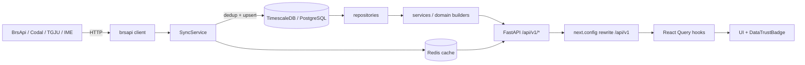
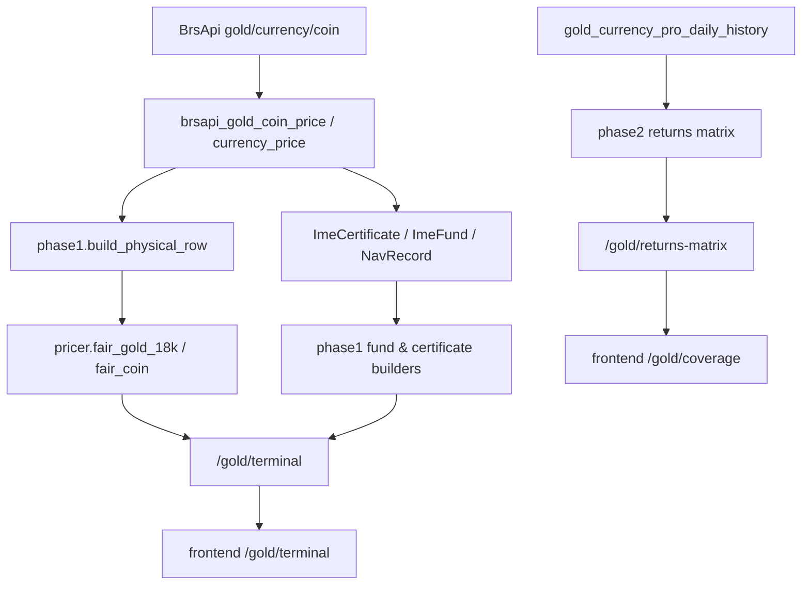

# نقشه معماری — فاز صفر

**مبنا:** کد موجود در commit `90597e05` روی شاخه `integration/golddesk-fixes`، تاریخ بررسی 2026-10-26.
**روش:** خواندن مستقیم کد، شمارش فایل‌ها با اسکریپت، بالا آوردن اپ FastAPI و شمارش routeها، اجرای تست‌ها. هیچ بخشی از این سند از روی نام فایل یا گزارش قدیمی استنباط نشده است.

---

## 1. نقطه ورود و لایه API

| مورد | مسیر | شواهد |
|---|---|---|
| اجرای اپ | `main.py` → `uvicorn apps.api.app:app` | `main.py:8-14` |
| ساخت اپ و middleware | `apps/api/app.py` | import موفق با `GOLD_API_TOKEN_SALT` |
| مونت routerها | `apps/api/router.py` | 714 route در اپ مونت‌شده |
| احراز هویت | `apps/api/auth.py`, `apps/api/dependencies.py` | `_require_user`, `_require_admin`, `_public_read` |
| میان‌افزارها | `apps/api/middleware.py` | لاگ `apps.api.middleware` در اجرای تست |

**شمارش واقعی routeها (اجرای `Router().setup()` و `app.routes`):**

- کل اپ: **714 route**
- بزرگ‌ترین سطوح: `api/v1/gold` = **108**، `api/v1/funds` = **84**، `api/v1/codal-professional` = **49**، `api/v1/brsapi` = **44**، `api/v1/options` = **39**، `api/v1/backtests` = **33**
- مسیرهای یکتای حاوی `/gold`: **103**؛ از این تعداد route با `ticker` در مسیر: **0** (نکته مهم برای ناسازگاری مستندات، ISSUE-104)

### چهار سطح موازی «طلا» (ریسک تکرار و واگرایی)

| سطح | فایل | Prefix نهایی | احراز هویت | تعداد مسیر |
|---|---|---|---|---|
| Gold Analytics | `apps/api/endpoints/gold_analytics.py` | `/api/v1/gold/analytics` | عمومی (بدون توکن) | ۲۶ route |
| Gold Core | `apps/api/endpoints/gold.py` | `/api/v1/gold` | `_require_user` | ۸۲ route |
| GoldDesk SaaS | `apps/api/endpoints/golddesk.py` | `/api/v1/golddesk` | توکن scoped | ۳ |
| GoldDesk شخصی | `src/gold_desk/api.py` | `/api/v1/gold` | `_require_user` (به‌جز `anonymous_router`) | ۶۵ route در router شخصی (شامل antigravity) |

شمارش‌ها بر اساس route (نه مسیر یکتا) از `Router().setup()` است: ۸۲ + ۲۶ + ۳ = ۱۱۱ route که به **۱۰۳ مسیر یکتا** زیر `/gold` و `/golddesk` نگاشت می‌شوند.
مسیرهای عمومی GoldDesk (بدون توکن، فقط خواندن): `/gold/assistant-rules`، `/gold/health`، `/gold/metrics`، `/gold/ws` (احراز هویت توکن داخل سوکت).
شواهد: خروجی `anonymous_router.routes` و `apps/api/router.py:262-301`.

> هشدار: docstring در `src/gold_desk/api.py:3` می‌گوید «بدون auth چون شخصی است»، اما mount واقعی در `apps/api/router.py:296` با `dependencies=_require_user` انجام می‌شود. کامنت کهنه است و می‌تواند در آینده باعث حذف ناخواسته گارد شود (ISSUE-108).

---

## 2. دامنه‌ها و ماژول‌های اصلی

شمارش فایل‌های `.py/.ts/.tsx` (بدون `__pycache__`/`node_modules`):

| ریشه | تعداد فایل |
|---|---|
| `apps` | 179 |
| `src` | 73 |
| `core` | 168 |
| `services` | 269 |
| `domain` | 219 |
| `brsapi` | 75 |
| `frontend/src` | 472 |
| `tests` | 562 |

### 2.1 `core/`
- `core/config/__init__.py` — تنظیمات Pydantic Settings، `AUTH_DISABLED` با پیش‌فرض `False` (`:122`)، هشدار production (`:442`).
- `core/indicators.py` — RSI/ATR/MACD/EMA/SMA/trend/volatility. بازبینی خط‌به‌خط انجام شد؛ پارامتر `period` در توابع مصرف می‌شود (ایداع قبلی «نادیده گرفته شدن period» بازتولید نشد).
- `core/database.py`، `core/cache`، `core/logging`، `core/time` — لایه‌های زیرساختی مشترک.

### 2.2 `services/`
- `services/quant_signal_orchestrator.py` — پایپ‌لاین ۶ مرحله‌ای سیگنال؛ زمان‌سنجی با `time.monotonic()` (باگ قبلی `_stage_time` در HEAD وجود ندارد؛ `grep -c _stage_time` = 0).
- `services/feature_engine.py` — ۱۱۹۹ خط، بلوک‌های A–…؛ فرمول‌های `float_turnover_pct` (`:515-527`) و `net_inst_ratio` (`:570-578`) اکنون مخرج شناور واقعی و clamp دارند.
- `services/options_analytics.py` — از `domain.options.pricing.implied_volatility` استفاده می‌کند (`:9`, `:144`)؛ مسیر رسیدن ورودی `T=0` به تابع بدون گارد (ISSUE-102).
- `services/gold/black76_engine.py`، `options_chain.py`، `options_matrix.py` — قیمت‌گذاری Black-76 طلا با IV محلی.

### 2.3 `domain/`
- `domain/options/pricing.py` — Black-Scholes + Greeks؛ گارد `gamma` برای `denom < 1e-12` و `isfinite` موجود است (`:166-175`).
- `domain/options/margin_engine.py` — موتور مارجین جهانی؛ `OptionLeg.contract_size` پیش‌فرض **1000** برای همه انواع legs از جمله `STOCK` (`:35-45`) → تشخیص covered call نادرست (ISSUE-101).
- `domain/options/var_calculator.py` — VaR/CVaR تاریخی/پارامتریک/مونت‌کارلو؛ گارد tail خالی موجود است، اما قرارداد واحد بازده مبهم است (ISSUE-103). در کل repo هیچ مصرف‌کننده‌ای خارج از خود فایل پیدا نشد.
- `domain/options/tree_pricing.py` — فرمول‌های menar/trinomial اکنون پیاده‌سازی شده (`:87-94`)؛ عبارت‌های مرده قبلی وجود ندارد.

### 2.4 `brsapi/`
- `brsapi/repositories/base.py` — `bulk_insert` با fallback روی `rowcount` و در نهایت `len(records)` (`:329-339`).
- `brsapi/services/sync_service.py` — ۱۸۱۲ خط؛ dedup key شامل `params` (`:352-355`)، upsert برای snapshot با `on_conflict_update` (`:458-473`).
- `brsapi/models/*`، `brsapi/jobs/*` — مدل‌ها و jobهای همگام‌سازی.

### 2.5 `frontend/`
- Next.js **16.2.9** + React **19.2.4**، Vitest 4، TypeScript 5 (`frontend/package.json`).
- `frontend/src/lib/api.ts` — `extractArray` در `:307`، refresh تک‌پرواز با `_refreshPromise` (`:76-115`)، `_handle401` (`:120`)، انتقال `AbortError` (`:181-186`).
- `frontend/src/hooks/useMarketData.ts` — هوک‌های داده زنده با `isLive/isError/isLoading` و `LiveDataBanner`؛ fallback ساکت به mock در این فایل پیدا نشد (import از `market-mock` فقط برای session است).
- صفحات طلا: **۲۲** فایل `page.tsx` زیر `frontend/src/app/gold/` (شمارش با `find`؛ شامل `terminal` و `coverage` که در کار جاری اضافه شده‌اند).

### 2.6 زیرساخت و داده
- `docker-compose.yml`: سرویس‌های `timescaledb`, `redis`, `backend`, `worker`, `currency`, `frontend`؛ متغیرهای حساس با `${VAR:?message}` اجباری شده‌اند (`:13,29,47-59,80-86,107-108`).
- `migrations/versions`: **86** فایل migration؛ head ثبت‌شده `0115` (فایل `_alembic_heads.txt`، خروجی قدیمی — اعتبار آن در فاز ۱ باید دوباره با `alembic heads` تأیید شود).
- `k8s/`, `nginx-golddesk.conf`, `monitoring/`, `prometheus.yml`, `Dockerfile.*` موجود.

---

## 3. جریان داده (Data Flow)

### 3.1 جریان طلا (فاز ۰→۲)

قواعد ثبت‌شده در کد و تأییدشده با تست:
- هر مقدار پولی **ریال** است مگر نام فیلد به `_usd` ختم شود (`src/gold_desk/phase1.py:3-10`، `phase2.py:3-16`).
- نقل‌قول‌های BrsApi فیزیکی **تومان** است و با `_toman_to_rial` تبدیل می‌شود.
- تاریخچه FX در `brsapi_gold_currency_pro_daily_history` مستقیماً **ریال** است و نباید ×۱۰ شود (تست `test_fx_history_is_already_rial_and_is_never_multiplied_by_ten`).
- داده غایب → `None` + `data_gaps` فارسی، هرگز صفر یا تخمین (تست‌های `test_missing_*`).

### 3.2 نقاط شکست مشترک

| نقطه | رفتار فعلی | شواهد |
|---|---|---|
| mount سطح شخصی طلا | `try/except` غیرکشنده + `logger.exception` | `apps/api/router.py:286-301` |
| Redis در دسترس نباشد | `null cache` با لاگ warning | خروجی تست: `Redis unavailable, using null cache` |
| PostgreSQL در دسترس نباشد | خطای asyncpg در تست‌ها؛ تست‌های `needs_db` اسکیپ می‌شوند | `tests/conftest.py` + لاگ اجرا |
| نبود salt توکن طلا | اپ بالا نمی‌آید (`RuntimeError`) | `src/gold_desk/api_token.py:35`؛ اجرای import بدون env شکست خورد |
| منبع قیمت کهنه | `DELAYED`/`NO_DATA`، بدون صفرگذاری | `freshness`/`phase1` + تست‌ها |

---

## 4. وابستگی‌های خارجی

| سرویس | کاربرد | شواهد |
|---|---|---|
| PostgreSQL/TimescaleDB | منبع اصلی داده تاریخی | `docker-compose.yml:4-24`، `DATABASE_URL` |
| Redis | cache و state مشترک | `docker-compose.yml:25-35` |
| BrsApi | قیمت طلا/ارز/کریپتو/سهام | `brsapi/` |
| Codal | اطلاعیه‌ها و صورت‌های مالی | `apps/api/endpoints/codal*.py` |
| IME | گواهی/صندوق/آتی | `brsapi/models/ime.py`، `phase1.py` |
| Telegram | ارسال هشدار | `src/gold_desk/api.py` (`/telegram/test`) |
| Sentry | پایش فرانت | `frontend/next.config.ts` |

---

## 5. اجرا، ساخت و استقرار

| کار | فرمان/فایل | شاهد |
|---|---|---|
| اجرای بک‌اند (dev) | `python main.py` → `uvicorn apps.api.app:app` | `main.py:8-14` |
| اجرای بک‌اند (کانتینر) | `Dockerfile.api` / سرویس `backend` در `docker-compose.yml:36-68` | compose |
| worker | `Dockerfile.worker` / سرویس `worker` (`:69-95`) | compose |
| سرویس ارز | `Dockerfile.currency` / سرویس `currency` (`:96-117`) | compose |
| فرانت (dev/build) | `npm run dev` / `npm run build` → `node scripts/build-with-heap.js` | `frontend/package.json:5-11` |
| فرانت (کانتینر) | `Dockerfile.frontend` + `next start` | compose `frontend:118-139` |
| lint بک‌اند | `ruff check .` | `pyproject.toml` + CI |
| typecheck بک‌اند | `mypy` (پیکربندی در pyproject؛ اجرا نشد) | `pyproject.toml` |
| lint/type/test فرانت | `npx eslint src`, `npx tsc --noEmit`, `npx vitest run` | `frontend/package.json` |
| production compose | `docker-compose.production.yml` + `nginx-golddesk.conf` | فایل‌ها موجود |
| K8s | `k8s/` | پوشه موجود |

**نکته:** فایل `next.config.ts` با `output: "standalone"` و `outputFileTracingRoot` ساخته می‌شود؛ `API_URL` در production باید صریحاً ست شود (fallback `http://api:8000`).

---

## 6. ریسک‌های معماری سطح بالا

1. **چهار سطح موازی طلا** با ownership و قرارداد مستقل؛ خطر واگرایی فرمول و مسیر.
2. **`apps/api/router.py` تک‌فایل بزرگ** (بیش از ۶۰۰ خط مونتاژ) با importهای داخل تابع؛ یک خطا در import یک سطح، فقط در `try/except` سطح طلا مهار می‌شود.
3. **تفکیک نشدن لایه `services/options_analytics` از `domain/options`**؛ باگ‌های دامنه مستقیماً به API می‌رسند.
4. **startup سنگین:** import اپ ۲۳.۶–۶۰.۴ ثانیه (۷۱۴ route، ۲۹۸۲ ماژول) — اندازه‌گیری‌شده؛ می‌تواند healthcheck و cold start کانتینر را تحت تأثیر بگذارد (ISSUE-109).
5. **داده و واحدها** بزرگ‌ترین منبع خطای خاموش است؛ قواعد ریال/تومان/دلار در چند فایل تکرار شده و تست دارند، اما یک قرارداد مرکزی تولید خودکار (schema) ندارند.
