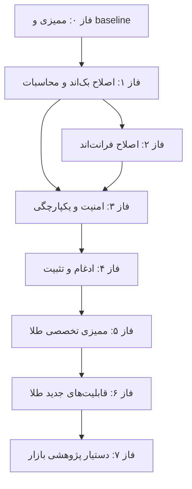

# نقشه راه — فاز صفر تا توسعه طلا

**اصل:** هیچ فازی شروع نمی‌شود مگر gates فاز قبل با شاهد اجرایی بسته شده باشد. «آماده بودن» به معنی سالم بودن نیست.

---

## فاز ۰ — ممیزی و ثبت baseline

| مورد | مقدار |
|---|---|
| مالک | دستیار ۳ (هماهنگ‌کننده) |
| ورودی | commit `90597e05`، working tree جاری |
| خروجی | **۱۷ سند** در `docs/audits/phase-0/` + شواهد اجرایی |
| معیار خروج | baseline ثبت‌شده، رجیستری با شاهد، مالکیت و gates روشن، محدودیت‌ها اعلام‌شده |
| شرط توقف | کشف خطای Critical در مسیر فعال بدون امکان مهار؛ یا نبود دسترسی لازم |

**وضعیت:** تکمیل‌شده در همین مجموعه (به‌جز اجرای کامل تست بک‌اند روی Windows که محدودیت ثبت شده است).

---

## فاز ۱ — اصلاح بک‌اند و محاسبات

| مورد | مقدار |
|---|---|
| مالک | دستیار ۱ |
| پیش‌نیاز | فاز ۰ تأییدشده؛ commit پایه مشترک؛ شاخه `fix/backend-finance` |
| کارها | ISSUE-101، ISSUE-102، ISSUE-103 (پس از تصمیم)، ISSUE-105، ISSUE-110؛ بازبینی S-01؛ تست‌های مرزی |
| خروجی | patch محدود + تست رگرسیون + گزارش `docs/audits/assistant-1-backend-report.md` |
| معیار خروج | هر ISSUE با تست پذیرش سبز؛ `ruff` بدون F821 جدید؛ هیچ تغییر API بدون قرارداد |
| شرط توقف | ابهام در فرمول مالی (مثلاً معنای contract_size) که مالک محصول تأیید نکرده |

---

## فاز ۲ — اصلاح فرانت‌اند

| مورد | مقدار |
|---|---|
| مالک | دستیار ۲ |
| پیش‌نیاز | قرارداد فیلدها با دستیار ۱ تثبیت شود (types/gold/phase1/phase2) |
| کارها | ISSUE-111، ISSUE-112، بازبینی S-02..S-05؛ تست‌های مؤلفه/هوک |
| خروجی | گزارش `docs/audits/assistant-2-frontend-report.md` + Vitest سبز + tsc صفر خطا |
| معیار خروج | هیچ حالت خطا/خالی بدون UI صریح؛ تست برای هر رفتار اصلاح‌شده |
| شرط توقف | تغییر قرارداد API لازم باشد (بازگشت به هماهنگی با ۱ و ۳) |

---

## فاز ۳ — امنیت و یکپارچگی

| مورد | مقدار |
|---|---|
| مالک | دستیار ۳ |
| پیش‌نیاز | فاز ۱ و ۲ mergeشده در شاخه ادغام |
| کارها | بازبینی مستقل diffها؛ تست contract؛ تست integration/E2E؛ چک‌لیست امنیتی؛ تست mount؛ بازبینی migration |
| خروجی | گزارش `docs/audits/assistant-3-integration-security-report.md` |
| معیار خروج | ۷۱۴ route بدون duplicate `(path,method)`؛ تست‌های gold mount سبز؛ هیچ secret جدید در diff |
| شرط توقف | کشف دسترسی غیرمجاز یا افشای secret → توقف فوری و گزارش |

---

## فاز ۴ — ادغام و تثبیت

| مورد | مقدار |
|---|---|
| مالک | دستیار ۳ + مالک محصول |
| پیش‌نیاز | سه گزارش فاز قبل؛ تست‌های سراسری |
| کارها | merge کنترل‌شده، اجرای مجدد کل تست‌ها، رفع رگرسیون، ارزیابی ریسک باقی‌مانده |
| معیار خروج | baseline جدید با خروجی کامل تست‌ها؛ فهرست موانع انتشار یا تأیید آمادگی |
| شرط توقف | رگرسیون حل‌نشده یا تست Critical قرمز |

---

## فاز ۵ — ممیزی تخصصی قابلیت‌های موجود طلا

| مورد | مقدار |
|---|---|
| مالک | دستیار ۱ + بازبینی دستیار ۳ |
| پیش‌نیاز | فاز ۴ تأییدشده؛ دسترسی به دیتابیس dev با داده واقعی |
| دامنه | صحت واحدها (ریال/تومان/دلار)، فرمول حباب و سکه، NAV صندوق‌ها، تازگی داده، returns matrix، کیفیت `NO_DATA` |
| خروجی | گزارش ممیزی طلا با جدول فرمول‌ها و تست‌های مرزی |
| معیار خروج | هر فرمول دارای تعریف مکتوب + تست با fixture ثابت؛ هیچ مقدار `NaN/Infinity` در پاسخ |
| شرط توقف | نبود منبع رسمی برای فرمول → ثبت تصمیم، عدم حدس |

---

## فاز ۶ — توسعه قابلیت‌های جدید طلا

| مورد | مقدار |
|---|---|
| مالک | دستیار ۱ (بک‌اند) + دستیار ۲ (UI) |
| پیش‌نیاز | فاز ۵ بسته؛ دامنه قابلیت تأییدشده توسط مالک محصول |
| الزامات هر قابلیت | قرارداد داده، schema، معیار پذیرش، تست، مسیر rollback |
| معیار خروج | قابلیت با تست end-to-end محلی؛ بدون سطح سفارش/پرداخت جدید |
| شرط توقف | نیاز به داده منبع ناموجود → `NO_DATA` به‌جای داده ساختگی |

---

## فاز ۷ — دستیار پژوهشی بازارهای مالی (آینده)

| مورد | مقدار |
|---|---|
| مالک | تعیین‌نشده (پیشنهاد: تیم جدا) |
| پیش‌نیاز | هسته پایدار (فاز ۴)، قرارداد داده و منبع، سیاست کیفیت داده |
| دامنه | جمع‌آوری شواهد از منابع مجاز، ثبت منبع/زمان، تفکیک واقعیت/فرضیه/پیش‌بینی، گزارش بازتولیدپذیر |
| الزام سخت | بدون کنترل ریسک، محیط آزمایشی، تأیید انسانی، idempotency، audit log و kill-switch، هیچ اقدام معامله‌ای زنده مجاز نیست |
| معیار خروج | گزارش قابل بازتولید + ارزیابی کیفیت داده + تست عدم تولید داده ساختگی |

---

## شرایط شروع توسعه قابلیت‌های جدید طلا (خلاصه gate)

1. فاز ۴ تأیید شده و baseline جدید تثبیت شده باشد.
2. هیچ ISSUE با شدت High در domain طلا باز نباشد.
3. فرمول‌های موجود (فاز ۵) تعریف مکتوب و تست ثابت داشته باشند.
4. قرارداد `/gold/*` با فرانت هم‌راستا و تست mount سبز باشد.
5. مالک محصول دامنه قابلیت جدید و «نبود سطح معامله» را تأیید کند.
6. تست‌های contract/unit/integration مرتبط از قبل وجود داشته باشند (test-first).
