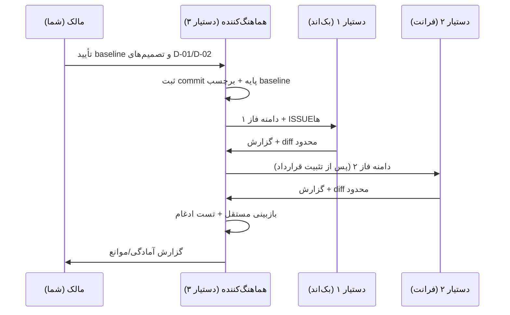

# Runbook اجرای سه دستیار — فاز صفر

**Baseline پیشنهادی:** `90597e05b9f4328bcd82ee819a31ba5c55413c12`
**پیش‌شرط قطعی:** working tree فعلی (۱۰ tracked + ۳۳ untracked + submodule `InkGist` dirty) **قبل از هر شاخه جدید** توسط مالکش commit یا stash شود. تا آن زمان هیچ شاخه اصلاحی ساخته نشود.

---

## 0. ترتیب کلی



**ترتیب اجباری:** فاز ۱ قبل از فاز ۲ (قرارداد داده)، فاز ۳ بعد از هر دو. ادغام نهایی فقط در فاز ۴.

---

## 1. آماده‌سازی baseline (مالک)

```bash
git status --short
git rev-parse HEAD          # باید 90597e05... باشد یا commit جدید ثبت شود
git diff --stat
# مالک کار جاری:
git add <only-current-work-paths>
git commit -m "wip: phase0/1/2 gold desk before audit fixes"
# یا: git stash push -u -m "pre-audit-wip"
```

سپس شاخه‌ها **فقط در صورت تمیز بودن** (هر شاخه از baseline جدید):

```bash
git switch -c fix/backend-finance
git switch -c fix/frontend-performance
git switch -c audit/integration-security
```

> شاخه‌های `fix/backend`, `fix/engine`, `feature/gold-platform` از قبل وجود دارند. قبل از ساخت نام مشابه، `git branch --list` و وضعیت آن‌ها بررسی شود؛ شاخه جدید کورکورانه ساخته نشود.

---

## 2. دستیار ۱ — اجرای فاز ۱

1. `git switch fix/backend-finance`
2. تسک‌ها را فقط از `ISSUE_REGISTRY` بردارد (ISSUE-101، 102، 105، 110؛ 103 پس از D-02).
3. برای هر ISSUE: ابتدا تست شکست‌خورده بنویسد، سپس اصلاح، سپس تست سبز.
4. diff را محدود نگه دارد؛ فایل مشترک (`apps/api/router.py`) را تغییر ندهد.
5. گزارش را در `docs/audits/assistant-1-backend-report.md` بنویسد (مسیر رسمی طبق پرامپت مادر): ISSUE، تغییر، فرمان، خروجی، باقی‌مانده.
6. commitها موضوعی: `fix(margin): ...`، `fix(options): ...`، `test(...): ...`.

**معیار خروج:** تست‌های T2/T4 مرتبط سبز؛ F821 صفر؛ هیچ تغییر قرارداد بدون ثبت در `API_CONTRACTS.md`.

---

## 3. دستیار ۲ — اجرای فاز ۲

1. `git switch fix/frontend-performance`
2. ورودی: قرارداد تثبیت‌شده فاز ۱ + ISSUE-111/112 + موارد S-02..S-05.
3. برای هر تغییر UI: تست Vitest همراهش.
4. `npx tsc --noEmit` و `npx eslint src` را قبل از گزارش اجرا کند.
5. گزارش: `docs/audits/assistant-2-frontend-report.md`.
6. فایل‌های `lib/goldApi.ts` و `types/*` را فقط با هماهنگی دستیار ۱ تغییر دهد.

**معیار خروج:** ۵۸۳+ تست سبز، tsc صفر، eslint صفر error، هیچ حالت خطا/خالی بدون UI صریح.

---

## 4. دستیار ۳ — امنیت و یکپارچگی

1. `git switch audit/integration-security`
2. ابتدا بازبینی مستقل diff دستیار ۱ و ۲ (بدون بازنویسی).
3. اجرای تست mount + contract + integration (در محیط با DB/Redis).
4. چک‌لیست `SECURITY_REVIEW_PLAN.md` را پر کند.
5. گزارش: `docs/audits/assistant-3-integration-security-report.md`.
6. تصمیم نهایی تعارض فایل مشترک با اوست (پس از مشورت با مالک اصلی).

**معیار خروج:** بدون duplicate route؛ secret gate سبز؛ تست integration سبز؛ ریسک‌های باقی‌مانده فهرست‌شده.

---

## 5. روش گزارش‌دهی (قالب ثابت)

```markdown
# گزارش فاز N — دستیار X
Baseline: <commit>
Branch: <branch>
Report path: docs/audits/assistant-<1|2|3>-...-report.md

## کارهای انجام‌شده
| ISSUE | تغییر | فایل‌ها | تست | نتیجه |

## فرمان‌ها و خروجی‌ها
<دقیقاً فرمان + خلاصه خروجی>

## باقی‌مانده / مسدود
| مورد | دلیل | مالک بعدی |

## ریسک‌های جدید
```

هیچ دستیاری گزارش دیگری را ویرایش نمی‌کند؛ فقط فایل خودش.

---

## 6. بازبینی و ادغام

1. بازبینی توسط دستیار ۳: `git diff --name-only <base>...HEAD` باید زیرمجموعه دامنه باشد.
2. بررسی: تست جدید وجود دارد؟ ادعای فرمول با سند/تست پشتیبانی می‌شود؟ قرارداد تغییر کرده؟
3. ادغام مرحله‌ای: ابتدا بک‌اند، سپس فرانت، سپس infra/contract.
4. بعد از هر ادغام: `pytest tests/unit` (بدون ml) + `pytest tests/gold_desk` + `vitest` + `tsc`.
5. پس از ادغام نهایی: اجرای مجدد کامل + ثبت baseline جدید.
6. **هیچ mergeای صرفاً به‌خاطر اتمام زمان تأیید نمی‌شود.**

---

## 7. ثبت تعارض

| فیلد | مقدار |
|---|---|
| فایل | مسیر دقیق |
| دستیاران درگیر | ۱/۲/۳ |
| علت | تغییر هم‌زمان / قرارداد مبهم / مالکیت نامشخص |
| تصمیم فنی | ارجاع به D-xx |
| تصمیم‌گیرنده | مالک اصلی فایل |
| تست پس از حل | فرمان و نتیجه |

---

## 8. شروط توقف فوری

- مشاهده secret واقعی جدید در diff → توقف، حذف از commit، چرخش کلید.
- تغییر رفتار auth/mount بدون تست → توقف.
- شکست تست Critical که با «skip» پوشانده شود → توقف.
- تغییر فرمول مالی بدون تعریف مکتوب → توقف و ارجاع به DECISIONS.
